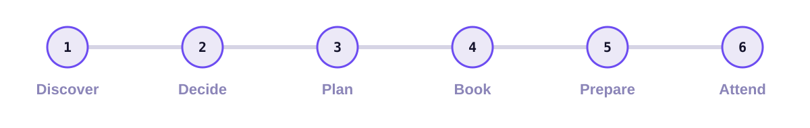
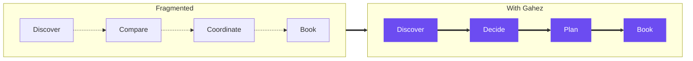
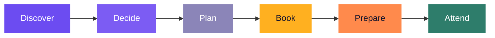

 

**[🌐 Live case study](https://abrarayman27.github.io/REPLACE-WITH-REPO-NAME/)** · **[🎨 Figma prototype](https://www.figma.com/proto/u0y7CaNRS6bvjC3WONKIaK/Gahez-?page-id=0%3A1&node-id=141-7&viewport=246%2C75%2C0.12&t=tkSiWlvFmbZFv6uU-1&scaling=scale-down&content-scaling=fixed&starting-point-node-id=141%3A2&show-proto-sidebar=1)** · **[🎯 Behance](https://www.behance.net/abrarayman2)** · **[📓 Notion](https://crocus-scilla-e79.notion.site/Gahez-3e2f9a827c4c805f892ce6b32c607527?source=copy_link)**

---

Gahez is an event discovery and planning platform that helps people move from **“What should we do?”** to an actual plan. By bringing event discovery, decision-making, planning, and ticket booking into one connected experience, Gahez makes it easier to find experiences that fit your interests and turn plans into reality.

## 📌 Project Overview

| | |
|---|---|
| **Role** | Product Designer — UX/UI, Research, Interaction Design |
| **Platform** | Mobile App & Website |
| **Project type** | End-to-end product design |
| **Tools** | Figma, FigJam |
| **Team** | Abrar Ayman · Alaa Ahmed · Mariam Auf · Sherin Ahmed |

## 🗂️ Contents

[01 Problem](#01--the-problem) · [02 Goal](#02--the-goal) · [03 Research](#03--research--discovery) · [04 Opportunities](#04--from-insights-to-opportunities) · [05 Strategy](#05--product-strategy--user-journey) · [06 IA & Flows](#06--information-architecture--user-flows) · [07 Design System](#07--visual-design--design-system) · [08 Experience](#08--the-experience) · [09 Decisions](#09--design-decisions) · [10 Outcome](#10--final-outcome) · [11 Reflection](#11--reflection)

---

## 01 · The Problem

Finding something enjoyable to do often means switching between platforms to discover events, compare options, coordinate plans, and book tickets. That fragmented process can make planning feel more complicated than the experience itself.

> **The design challenge:** How might we help users discover relevant events and turn their interest into a clear, organized, and bookable plan?

## 02 · The Goal

We designed a connected experience that supports users throughout their event journey, from initial inspiration to preparation and attendance. We focused on making it easier to:

| | Goal |
|---|---|
| 🔍 | **Discover** events that match personal interests |
| ⚖️ | **Compare** options before deciding |
| 🗓️ | **Organize** plans around personal preferences |
| 🎟️ | **Book** tickets through a clear, understandable flow |
| 🧭 | **Prepare** with relevant event information |

## 03 · Research & Discovery

Our research explored users’ event-discovery habits, planning challenges, and expectations when choosing activities. It informed our understanding of the journey from discovering an event to committing to a plan.

<b>Key areas of investigation</b> (click to expand)

 

- How users currently discover events and activities
- What influences their decisions when comparing options
- Where friction appears during planning and booking
- What information users need before committing to an event

> [!NOTE]
> Add your actual survey findings, interview insights, participant count, and supporting evidence here. Include only findings your research supports.

## 04 · From Insights to Opportunities

Research observations became opportunities to improve the experience:

| Area | Opportunity |
|---|---|
| **Discovery** | Make exploring events intuitive and engaging |
| **Decision-making** | Present useful event information to support comparison |
| **Personalization** | Help users find options relevant to their interests |
| **Planning** | Connect event discovery with practical next steps |
| **Booking** | Keep the ticket-booking journey clear and transparent |

These opportunities shaped the information architecture, user flows, and interface decisions.

## 05 · Product Strategy & User Journey

Gahez is designed around one connected journey:

Instead of treating event discovery and ticket booking as separate activities, the product connects them in one experience. The mobile app supports exploring and managing plans, while the website provides a complementary way to access the platform.

## 06 · Information Architecture & User Flows

We structured the experience around the key tasks users need to complete, helping them move between discovery, personalization, event details, and planning. The user flows clarified how people move through the product and which screens each step needs.

> [!NOTE]
> Add your information architecture diagram and your most important user flows here, for example ``.

## 07 · Visual Design & Design System

The visual direction uses a confident purple palette for a recognizable, cohesive identity. The system includes reusable components, typography, color tokens, and interaction states, with light and dark themes, so the mobile app and website stay consistent and easy to scale.

| Role | Typeface |
|---|---|
| Headings, UI, body | Space Grotesk |
| Prices and numbers | Sora |
| Ticket IDs, seat codes | JetBrains Mono |
| Arabic | IBM Plex Sans Arabic |

## 08 · The Experience

<table>
<tr>
<td align="center" width="25%"> <b>Personalization & Discovery</b></td>
<td align="center" width="25%"> <b>Event Details</b></td>
<td align="center" width="25%"> <b>Home</b></td>
<td align="center" width="25%"> <b>Get Started</b></td>
</tr>
</table>

<b>Personalization & Discovery</b>

 

The experience helps users explore activities and events based on their interests, making discovery the starting point for a more relevant journey.

<b>Event Details</b>

 

Event details bring essential information together to help users evaluate an option before deciding whether to proceed.

<b>Planning & Booking</b>

 

The product connects the decision to attend with the next steps, reducing the need to manage the process across disconnected experiences.

<b>Mobile & Web</b>

 

Both platforms share a consistent visual language, while each interface supports its own users and tasks.

## 09 · Design Decisions

| Decision | Why |
|---|---|
| **Connected journeys** | Link discovery to planning and booking rather than treating each stage independently |
| **Consistent components** | Reuse design-system elements across screens and platforms |
| **Clear information hierarchy** | Help users identify relevant event details and available actions |
| **Light and dark themes** | Offer alternative presentations while keeping the product consistent |

## 10 · Final Outcome

Gahez brings event discovery, planning, and ticket booking together in one product concept. The project let us explore how product strategy, research, interaction design, and a reusable design system work together to support a more connected user experience.

> [!NOTE]
> Add validated usability findings, task-completion results, or other measured outcomes here. Don’t present unmeasured improvements as proven results.

## 11 · Reflection

Gahez reinforced the importance of designing beyond individual screens. A useful event platform needs to support the entire decision-making journey, from helping someone find an idea to giving them the information and tools to act on it. The project also showed the value of a shared design system for a consistent experience across mobile and web.

> **Key takeaway:** Great product design does not just help people discover possibilities. It helps them turn those possibilities into action.

---

**Designed by [Abrar Ayman](https://abrarayman27.github.io/abrar-ayman-portfolio/)**
Product Design · UX Research · Interaction Design · UI Systems

[Portfolio](https://abrarayman27.github.io/abrar-ayman-portfolio/) · [LinkedIn](https://www.linkedin.com/in/abrar-ayman/) · [Behance](https://www.behance.net/abrarayman2)

